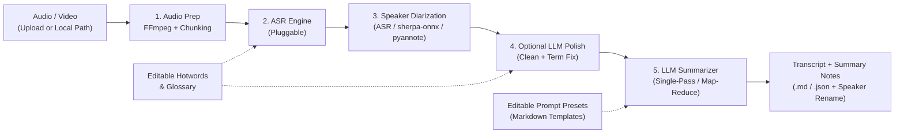

# audio-to-note

[English](README.md) | [简体中文](README.zh-CN.md)

**A modular, local-first pipeline to turn any audio or video recording into clean speaker-labeled transcripts and structured AI notes — via Web GUI or CLI.**

No model weights are bundled with this repository. Bring your own local models (VibeVoice GGUF, faster-whisper, sherpa-onnx, Ollama, vLLM, llama.cpp) or connect any OpenAI-compatible API.

---

## Architecture



## Quick Start

### 1. Prerequisites
- Python **3.10+**
- `ffmpeg` and `ffprobe` on `PATH` (`sudo apt install ffmpeg` / `brew install ffmpeg`)

### 2. Install

```bash
git clone https://github.com/<your-username>/audio-to-note.git
cd audio-to-note

python -m venv .venv
source .venv/bin/activate
pip install -e .
```

Optional extras (install only what you want):
```bash
pip install -e ".[whisper]"          # Local faster-whisper ASR
pip install -e ".[diarize-onnx]"     # Local sherpa-onnx speaker diarization (no HF token)
pip install -e ".[diarize-pyannote]" # Local pyannote.audio diarization (PyTorch)
```

### 3. Configure & Check Environment

```bash
audio-to-note init     # Creates gitignored config/config.yaml & .env
audio-to-note doctor   # Checks FFmpeg, GPU, local models, and LLM connectivity
```

### 4. Launch Web GUI or Run CLI

**Web GUI (recommended):**
```bash
audio-to-note serve
# Open http://127.0.0.1:8000 in your browser
```

**CLI:**
```bash
# Full pipeline (Audio -> Transcript -> Summary)
audio-to-note run meeting.mp4 --asr faster_whisper --diarize sherpa_onnx --prompt meeting_minutes

# Transcribe only
audio-to-note transcribe meeting.mp4 --asr crispasr

# Summarize (or re-summarize) an existing transcript with a different prompt or LLM
audio-to-note summarize outputs/20261125-120000_meeting --prompt research_discussion --model deepseek-chat
```

---

## Key Features

- **5 Modular Stages (All Behind Clean Interfaces)**:
  1. **Audio Prep**: FFmpeg probes and normalizes any audio/video (`mp4`, `mp3`, `m4a`, `wav`, `mkv`, `webm`, ...) with automatic overlapping windowing for multi-hour recordings.
  2. **ASR Transcription**:
     - `openai_compat`: `/v1/audio/transcriptions` (OpenAI, Groq, local `speaches`, `whisper.cpp` server, `vLLM`).
     - `crispasr` / `audio_cpp` / `vibeasr_cpp`: Local VibeVoice-ASR GGUF backends (Q4/Q8 CUDA and BitNet CPU).
     - `faster_whisper`: Optional in-process Python Whisper (`pip install -e ".[whisper]"`).
     - `command`: Generic CLI template for any external ASR tool.
  3. **Optional Dedicated Speaker Diarization**:
     - `none`: Keep speaker labels emitted by the ASR model.
     - `sherpa_onnx`: Lightweight local ONNX diarization (**no PyTorch, no Hugging Face token**).
     - `pyannote`: High-accuracy local `pyannote/speaker-diarization-3.1`.
  4. **Optional Transcript Polish**: Clean filler words, fix punctuation, and apply `wrong -> right` glossary rules while keeping `[HH:MM:SS] SPEAKER_X` timestamps intact.
  5. **AI Summarization**:
     - Works with any OpenAI-compatible `/v1/chat/completions` endpoint (**vLLM**, **llama-server**, **Ollama**, **LM Studio**, **OpenAI**, **DeepSeek**, **Gemini**, **OpenRouter**) or local `llama-cli`.
     - Automatically switches to **Map-Reduce** chunked summarization when a long transcript exceeds your model's context budget.
- **Zero-Build Local Web GUI (`audio-to-note serve`)**:
  - Drag-and-drop upload or browse local files directly (ideal for WSL2 + large files).
  - Auto-detects local `.gguf` / `.onnx` models, binaries, GPU, and API readiness.
  - Live progress + streaming LLM output, inline speaker renaming (`SPEAKER_0` -> `Alice`), editable hotwords & prompts, and one-click re-summarization.

---

## Recommended Models (Not Bundled)

See [docs/models.md](docs/models.md) for download commands and detailed benchmarks.

| Setup Tier | ASR Engine | Diarization | Summarizer LLM |
|---|---|---|---|
| **Local GPU (12–16 GB VRAM)** | `VibeVoice-ASR Q4_K_M` (CrispASR) or `faster-whisper large-v3-turbo` | `sherpa-onnx` or `pyannote 3.1` | `Qwen2.5-7B/14B-Instruct` via Ollama / vLLM / llama-server |
| **Local CPU / Laptop** | `faster-whisper small` (int8) or `VibeVoice-ASR-BitNet` | `sherpa-onnx` (~200 MB RAM) | `Qwen2.5-3B/7B` Q4 via Ollama / llama-server |
| **Zero Local Setup (Cloud API)** | OpenAI `whisper-1` / `gpt-4o-mini-transcribe` or Groq | `none` or `sherpa-onnx` | OpenAI / DeepSeek / Gemini (OpenAI-compat) |
| **Hybrid (Daily Driver)** | Local `VibeVoice Q4` or `faster-whisper` (free & private) | `sherpa-onnx` | Cloud API or local vLLM |

---

## Editable Hotwords & Prompt Templates

- **Hotwords**: Stored in `config/hotwords.local.txt` (gitignored; template in [config/hotwords.example.txt](config/hotwords.example.txt)). Lines starting with `#` are ignored. Supports `wrong term -> right term` and `Term: description` syntax.
- **Prompts**: Built-in templates live in [src/audio_to_note/prompts/](src/audio_to_note/prompts/) (`meeting_minutes`, `research_discussion`, `lecture_notes`, `transcript_polish`). Editing via the Web GUI or placing `.md` files in `prompts/` overrides or adds templates cleanly.

---

## Documentation

- [Model Selection & Setup Guide](docs/models.md)
- [Local C++ Runtime Build Notes (CrispASR / audio.cpp / VibeASR.cpp)](docs/local-runtimes.md)
- [Contributing](CONTRIBUTING.md)
- [Changelog](CHANGELOG.md)

## License

[MIT](LICENSE)
