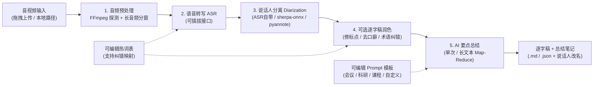

# audio-to-note

[English](README.md) | [简体中文](README.zh-CN.md)

**一个轻量、模块化、本地优先的“音视频 → 逐字稿 → 说话人分离 → AI 要点总结”工具，提供直观的本地 Web GUI 与命令行界面。**

本仓库**不包含任何模型权重文件**。你可以自由接入本地模型（VibeVoice GGUF、faster-whisper、sherpa-onnx、Ollama、vLLM、llama.cpp），或任意 OpenAI 兼容商业 API。

---

## 整体流程架构



## 快速开始

### 1. 环境准备
- Python **3.10+**
- 已安装 `ffmpeg` 和 `ffprobe`（例如 `sudo apt install ffmpeg`）

### 2. 安装

```bash
git clone https://github.com/<your-username>/audio-to-note.git
cd audio-to-note

python -m venv .venv
source .venv/bin/activate
pip install -e .
```

按需安装可选模块：
```bash
pip install -e ".[whisper]"          # 本地 faster-whisper 转写
pip install -e ".[diarize-onnx]"     # 本地 sherpa-onnx 说话人分离（免 Token）
pip install -e ".[diarize-pyannote]" # 本地 pyannote.audio 高精度分离
```

### 3. 初始化与环境自检

```bash
audio-to-note init     # 交互式生成被 .gitignore 忽略的 config/config.yaml 与 .env
audio-to-note doctor   # 一键检查 FFmpeg、GPU、本地模型文件与 LLM 连通性
```

### 4. 启动 Web GUI 或使用 CLI

**启动 Web GUI（推荐）：**
```bash
audio-to-note serve
# 在浏览器打开 http://127.0.0.1:8000
```

**常用 CLI 命令：**
```bash
# 完整流程（音视频 -> 转写 -> 声纹分离 -> 总结）
audio-to-note run meeting.mp4 --asr crispasr --diarize sherpa_onnx --prompt meeting_minutes

# 仅转写
audio-to-note transcribe meeting.mp4 --asr crispasr

# 对已有逐字稿或历史任务，换一个 Prompt 或 LLM 重新总结（无需重跑 ASR）
audio-to-note summarize outputs/20261125-120000_meeting --prompt research_discussion --model deepseek-chat
```

---

## 核心特性

- **五阶段积木式接口（每一块都能独立开关、单独运行或重跑）**：
  1. **音频预处理**：FFmpeg 自动兼容 MP4/MP3/WAV/M4A/MKV 等格式；超长录音自动切片重叠并无缝拼接，同时支持中英文边界去重。
  2. **语音转写（ASR）**：
     - `openai_compat`：标准 `/v1/audio/transcriptions`（支持 OpenAI、Groq、本地 `speaches`、`whisper.cpp` server、`vLLM`）。
     - `crispasr` / `audio_cpp` / `vibeasr_cpp`：本地 VibeVoice-ASR GGUF 引擎（CUDA Q4/Q8 与 CPU BitNet）。
     - `faster_whisper`：可选本地 Python Whisper（`pip install -e ".[whisper]"`，免编译开箱即用）。
     - `command`：通用命令行模板，可挂载任意外部 ASR 工具。
  3. **独立说话人分离（Diarization，解决 ASR 标签飘移）**：
     - `none`：保留 ASR 自带说话人标签。
     - `sherpa_onnx`：纯本地 ONNX 声纹分离（**无需 PyTorch，无需 Hugging Face Token**，模型仅 ~35 MB）。
     - `pyannote`：高精度本地 `pyannote/speaker-diarization-3.1`。
  4. **可选逐字稿润色**：结合词表清理口癖、补全标点、修复专有名词误识别，同时保留 `[HH:MM:SS] SPEAKER_X` 时间戳。
  5. **AI 要点归纳**：
     - 统一 OpenAI 兼容接口，通吃 **vLLM / llama-server / Ollama / LM Studio / OpenAI / DeepSeek / Gemini / OpenRouter**，另支持本地 `llama-cli` 直跑 GGUF。
     - 当逐字稿超出本地模型上下文预算时，自动触发 **Map-Reduce 分段总结**，防止长会议被截断。
- **零前端构建的本地 Web GUI（`audio-to-note serve`）**：
  - WSL2 下直接在 Windows 浏览器中访问，支持**拖拽上传**或**直接浏览本机路径**（大视频无需复制上传）。
  - 自动扫描本地 `models/` 目录下的 `.gguf` / `.onnx`、运行时二进制文件、GPU 与 API 状态。
  - 实时进度条 + LLM 流式输出预览、在线把 `SPEAKER_0` 改成真实姓名、实时编辑热词表与 Prompt 模板、一键换模型/Prompt 重新总结。

---

## 推荐模型组合（仓库不内置模型）

详细下载命令见 [docs/models.md](docs/models.md)：

| 硬件档位 | 推荐 ASR | 推荐说话人分离 | 推荐总结 LLM |
|---|---|---|---|
| **本地独显 (12–16 GB)** | `VibeVoice-ASR Q4_K_M` (CrispASR) 或 `faster-whisper large-v3-turbo` | `sherpa-onnx` 或 `pyannote 3.1` | `Qwen2.5-7B/14B-Instruct`（Ollama / vLLM / llama-server） |
| **纯 CPU / 轻薄本** | `faster-whisper small` (int8) 或 `VibeVoice-ASR-BitNet` | `sherpa-onnx`（内存 ~200 MB） | `Qwen2.5-3B/7B` Q4（Ollama / llama-server） |
| **零本地部署 (纯云端)** | OpenAI `whisper-1` / Groq Whisper | `none` 或 `sherpa-onnx` | OpenAI / DeepSeek / Gemini（OpenAI 兼容接口） |
| **混合推荐 (性价比最高)** | 本地 `VibeVoice Q4` / `faster-whisper`（免费且隐私） | `sherpa-onnx` | 本地 vLLM 或 云端 DeepSeek / GPT-4o / Gemini |

---

## 许可协议

[MIT](LICENSE)
